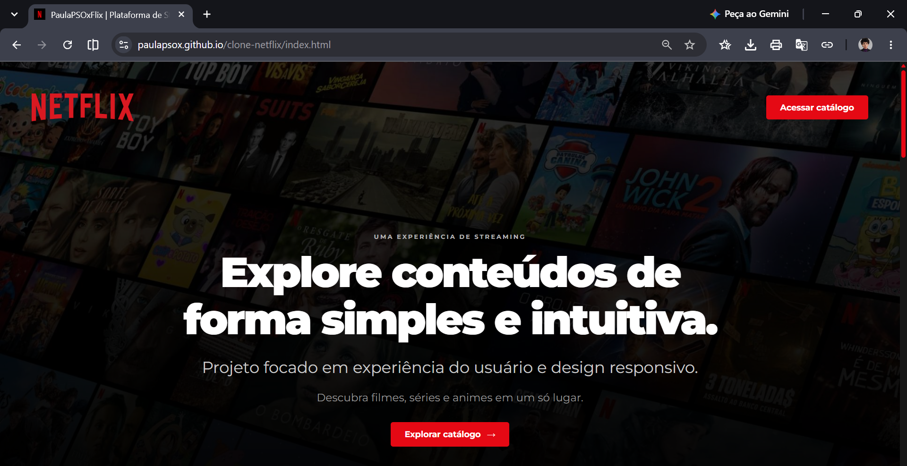
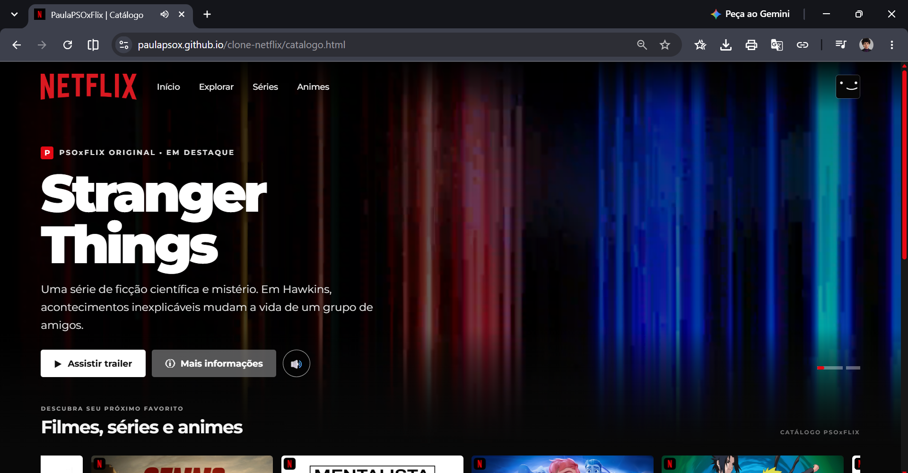

# 🎬 PaulaPSOxFlix — Plataforma de Streaming

Projeto front-end inspirado na interface de plataformas de streaming, desenvolvido para praticar e demonstrar conhecimentos em **HTML, CSS e JavaScript**.

A aplicação apresenta uma página inicial e um catálogo de conteúdos, com identidade visual inspirada na experiência de navegação da Netflix.

## 🌐 Acesse o projeto

- **[Visualizar aplicação](https://paulapsox.github.io/clone-netflix/)**
- **[Acessar repositório no GitHub](https://github.com/paulaPSOx/clone-netflix)**

## 🖥️ Demonstração

### Página inicial



### Catálogo



## ✨ Funcionalidades

- Página inicial com identidade visual inspirada em plataformas de streaming.
- Catálogo organizado para apresentar diferentes conteúdos.
- Navegação entre as páginas.
- Reprodução e interação com trailers.
- Controles de áudio.
- Seleção de avatares.
- Modal com informações dos conteúdos.
- Elementos interativos desenvolvidos com JavaScript.
- Layout responsivo para diferentes tamanhos de tela.

## 🛠️ Tecnologias utilizadas

| Tecnologia | Aplicação |
|---|---|
| HTML5 | Estrutura e organização do conteúdo |
| CSS3 | Estilização, layout e responsividade |
| JavaScript | Interações e funcionalidades |
| Google Fonts | Tipografia |
| Bootstrap | Recursos de interface utilizados no catálogo |
| Git e GitHub | Versionamento e publicação |

## 🎨 Identidade visual

O projeto utiliza uma identidade visual inspirada em serviços de streaming, com predominância de tons escuros e vermelho.

- **Preto:** plano de fundo e identidade visual.
- **Vermelho:** destaques e elementos de interação.
- **Branco:** textos e informações principais.
- **Cinza:** elementos secundários.

A tipografia Montserrat contribui para uma apresentação moderna e consistente.

## 📂 Estrutura do projeto

A organização abaixo representa os principais arquivos e diretórios utilizados no projeto:

```text
clone-netflix/
│
├── index.html
├── catalogo.html
│
├── css/
│   ├── style.css
│   └── catalogo.css
│
├── js/
│   ├── script.js
│   └── catalogo.js
│
├── midia/
│   ├── img/
│   ├── video/
│   └── audio/
│
├── img-clone-netflix-inicial.png
├── img-clone-netflix-catalogo.png
│
└── README.md
```

## 🚀 Como executar o projeto

1. Clone este repositório:

```bash
git clone https://github.com/paulaPSOx/clone-netflix.git
```

2. Entre na pasta:

```bash
cd clone-netflix
```

3. Abra o arquivo `index.html` no navegador.

Não é necessário instalar dependências para visualizar a versão estática do projeto.

## 📚 Aprendizados

Durante o desenvolvimento, foram trabalhados conceitos importantes de desenvolvimento front-end:

- Estruturação de páginas com HTML semântico.
- Estilização e organização de layouts com CSS.
- Manipulação do DOM com JavaScript.
- Eventos e interações com o usuário.
- Organização de arquivos e recursos do projeto.
- Responsividade e experiência de navegação.
- Publicação de projetos utilizando GitHub Pages.

## ⚠️ Aviso

Este é um projeto independente, desenvolvido para fins educacionais e de portfólio. Não possui vínculo, parceria ou afiliação com a Netflix. Marcas e referências visuais pertencem aos seus respectivos proprietários.

## 👩🏻‍💻 Desenvolvido por

**Paula Oliveira**

- [GitHub](https://github.com/paulaPSOx)
- [LinkedIn](https://www.linkedin.com/in/oliveiraspaula/)

---

*Desenvolvido com dedicação, prática e aprendizado contínuo.* 💻
